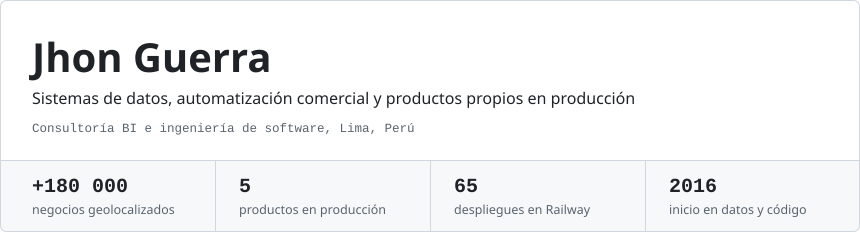
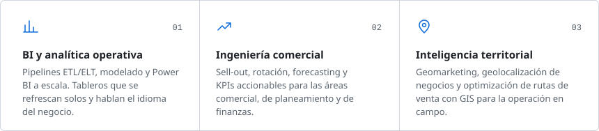
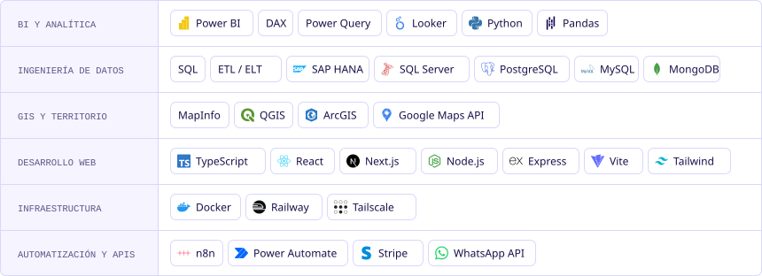
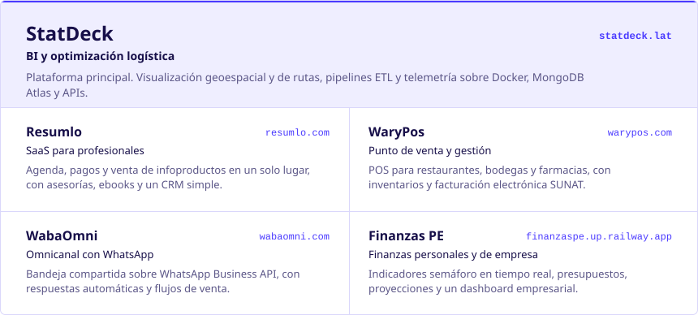
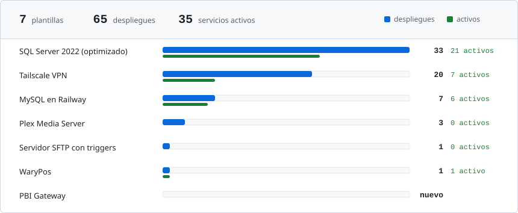

<picture>
  <source media="(prefers-color-scheme: dark)" srcset="./assets/header-dark.svg"/>
  <source media="(prefers-color-scheme: light)" srcset="./assets/header-light.svg"/>
  
</picture>

<a href="https://www.linkedin.com/in/kennethguerras">LinkedIn</a>&nbsp;&nbsp;&nbsp;&nbsp;<a href="mailto:kenneth.guerra@outlook.com">Correo</a>&nbsp;&nbsp;&nbsp;&nbsp;<a href="https://l.resumlo.com/meeting">Agendar 30 minutos</a>&nbsp;&nbsp;&nbsp;&nbsp;<a href="https://x.com/JhonkGuerra">X</a>&nbsp;&nbsp;&nbsp;&nbsp;<a href="https://l.resumlo.com/jhonguerra">Todos mis enlaces</a>

## Sobre mí

Transformo datos comerciales en decisiones rentables. Construyo pipelines ETL y tableros automatizados con Power BI, DAX, SQL, Python y SAP HANA, y domino el negocio detrás de los números: sell-in y sell-out, rotación de stock, planificación de la demanda, precios e inventarios.

Complemento el análisis con **inteligencia territorial**: geolocalicé más de 15 000 negocios y planifiqué rutas de venta a nivel nacional con MapInfo, QGIS y ArcGIS. Además, construyo y opero mis propios productos en la nube.

## Lo que resuelvo

<picture>
  <source media="(prefers-color-scheme: dark)" srcset="./assets/practica-dark.svg"/>
  <source media="(prefers-color-scheme: light)" srcset="./assets/practica-light.svg"/>
  
</picture>

## Trayectoria

<picture>
  <source media="(prefers-color-scheme: dark)" srcset="./assets/trayectoria-dark.svg"/>
  <source media="(prefers-color-scheme: light)" srcset="./assets/trayectoria-light.svg"/>
  
</picture>

Formación: Business Analytics: Data to Insights en The Wharton School (2022) y Marketing y Gestión Comercial en Zegel (en curso).

## Stack

<picture>
  <source media="(prefers-color-scheme: dark)" srcset="./assets/stack-dark.svg"/>
  <source media="(prefers-color-scheme: light)" srcset="./assets/stack-light.svg"/>
  
</picture>

## Productos propios

<picture>
  <source media="(prefers-color-scheme: dark)" srcset="./assets/productos-dark.svg"/>
  <source media="(prefers-color-scheme: light)" srcset="./assets/productos-light.svg"/>
  
</picture>

Abrir:&nbsp;&nbsp;&nbsp;&nbsp;<a href="https://statdeck.lat/">StatDeck</a>&nbsp;&nbsp;&nbsp;&nbsp;<a href="https://resumlo.com/">Resumlo</a>&nbsp;&nbsp;&nbsp;&nbsp;<a href="https://www.warypos.com/">WaryPos</a>&nbsp;&nbsp;&nbsp;&nbsp;<a href="https://wabaomni.com/">WabaOmni</a>&nbsp;&nbsp;&nbsp;&nbsp;<a href="https://finanzaspe.up.railway.app/">Finanzas PE</a>

## Plantillas en Railway

<picture>
  <source media="(prefers-color-scheme: dark)" srcset="./assets/railway-dark.svg"/>
  <source media="(prefers-color-scheme: light)" srcset="./assets/railway-light.svg"/>
  
</picture>

| Plantilla | Para qué sirve | Código | Railway |
| :--- | :--- | :--- | :--- |
| **SQL Server 2022 (optimizado)** | SQL Server 2022 persistente y listo para producción. | [Repositorio](https://github.com/Kennethguerra3/SqlServer2022Docker) | [Desplegar](https://railway.com/deploy/sql-server-2022-en-railway-optimizado?referralCode=DFuuA2&utm_medium=integration&utm_source=template&utm_campaign=generic) |
| **Tailscale VPN** | Red privada mesh con Exit Node y proxy SOCKS5. | [Repositorio](https://github.com/Kennethguerra3/tailscale-vpn-Docker) | [Desplegar](https://railway.com/deploy/terrific-vitality) |
| **MySQL en Railway** | Instancia MySQL optimizada y lista para conectar. | [Repositorio](https://github.com/Kennethguerra3/Mysql_railway) | [Desplegar](https://railway.com/deploy/mysql-en-railway) |
| **Plex Media Server** | Servidor multimedia en contenedores, preconfigurado. | [Repositorio](https://github.com/Kennethguerra3/plex-railway-template) | [Desplegar](https://railway.com/deploy/pms-docker-railway) |
| **Servidor SFTP con triggers** | Servidor de archivos privado que dispara eventos al recibir archivos. | [Repositorio](https://github.com/Kennethguerra3/ServidorSFTP) | [Desplegar](https://railway.com/deploy/servidor-sftp-dockerizado-con-event-trig) |
| **WaryPos** | POS y gestión para negocios peruanos, con PostgreSQL privado incluido. | Privado | [Desplegar](https://railway.com/deploy/warypos) |
| **PBI Gateway** | Puente HTTPS para que Power BI consulte SQL Server sin el gateway on-premise. | Privado | [Desplegar](https://railway.com/deploy/pbi-gateway) |

También mantengo [SQL Server 2025](https://github.com/Kennethguerra3/SqlServer2025Docker) (solo para pruebas) y [SQL Server 2019](https://github.com/Kennethguerra3/SqlServer2019Docker) para escenarios de compatibilidad.

## Hablemos

Si tienes un reto de datos, territorio u operación comercial, escríbeme a [kenneth.guerra@outlook.com](mailto:kenneth.guerra@outlook.com) o [agenda 30 minutos](https://l.resumlo.com/meeting) en mi calendario.
