<!--
  README de perfil de Kennethguerra3
  Los gráficos viven en la carpeta assets/ de este mismo repo, por eso no
  dependen de servicios externos. Si falta la carpeta assets/, no se verán.
-->

  

  
  
  
  
  

  

## Sobre mí

Trabajo en la intersección del **Business Intelligence** y el **negocio**. No solo construyo pipelines y tableros: entiendo el sell-out, la rotación y la demanda que hay detrás, y eso hace que lo que reporto se traduzca en decisiones.

Lo que me diferencia es el cruce con la **inteligencia territorial**. Geolocalicé más de 180 000 negocios y planifiqué rutas de venta a nivel nacional con MapInfo, QGIS y ArcGIS. Además, construyo y opero mis propios productos en la nube.

## Lo que resuelvo

  

## Stack

  

## Productos propios

Cinco productos en producción. Haz clic en cualquiera para abrirlo.

  
  

  
  

  

## Plantillas en Railway

Infraestructura que uso en mis proyectos, publicada para que cualquiera la despliegue en un clic.

  

| Plantilla | Para qué sirve | Código | Desplegar |
| :--- | :--- | :---: | :---: |
| **SQL Server 2022 (optimizado)** | SQL Server 2022 persistente y listo para producción. | [Repo](https://github.com/Kennethguerra3/SqlServer2022Docker) |  |
| **Tailscale VPN** | Red privada mesh con Exit Node y proxy SOCKS5. | [Repo](https://github.com/Kennethguerra3/tailscale-vpn-Docker) |  |
| **MySQL en Railway** | Instancia MySQL optimizada y lista para conectar. | [Repo](https://github.com/Kennethguerra3/Mysql_railway) |  |
| **Plex Media Server** | Servidor multimedia en contenedores, preconfigurado. | [Repo](https://github.com/Kennethguerra3/plex-railway-template) |  |
| **Servidor SFTP con triggers** | Servidor de archivos privado que dispara eventos al recibir archivos. | [Repo](https://github.com/Kennethguerra3/ServidorSFTP) |  |
| **WaryPos** | POS y gestión para negocios peruanos, con PostgreSQL privado incluido. | Privado |  |
| **PBI Gateway** | Puente HTTPS para que Power BI consulte SQL Server sin el gateway on-premise. | Privado |  |

También mantengo <a href="https://github.com/Kennethguerra3/SqlServer2025Docker">SQL Server 2025</a> (solo para pruebas) y <a href="https://github.com/Kennethguerra3/SqlServer2019Docker">SQL Server 2019</a> para escenarios de compatibilidad.

## Actividad

  

## Hablemos

Si tienes un reto de datos, territorio u operación comercial, escríbeme o agenda 30 minutos directo en mi calendario.

  
  
  
  
  

De la cancha al código

